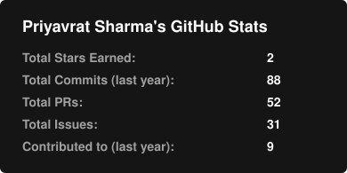
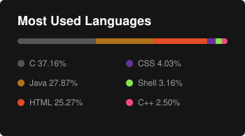

<h1 align="center">Priyavrat Dev Sharma</h1>

<b>Research Software Developer · Networking &amp; Distributed Systems · Applied ML</b> 
MSc Electrical and Computer Engineering, McGill University 
Open to roles across Canada · Authorized to work in Canada, no sponsorship required

---

### About

I build reliable software and networks for research, IoT and connected systems. At the **McGill Centre for Integrative Neuroscience (MCIN)** I work on [LORIS](https://github.com/aces/Loris), an open source platform for neuroimaging and clinical research data, across PHP, MySQL, React and Linux, with release testing, SQL migrations and access control review.

**Highlights**

- 🔐 **Two published security advisories** in LORIS, credited to me as reporter: [GHSA-f488-7r46-r42v](https://github.com/aces/Loris/security/advisories/GHSA-f488-7r46-r42v) (CWE-862, CVSS 5.4) and [GHSA-3vv3-x7q8-46vr](https://github.com/aces/Loris/security/advisories/GHSA-3vv3-x7q8-46vr) (CWE-639, CVSS 4.3), fixed in 27.0.4 and 28.0.2
- 🔀 **Merged open source work** across LORIS, Cisco, Meraki and HarmoniCA
- 📄 **IEEE ICC 2025 paper** on UAV network routing: a heuristic at least 99% faster than an exact CPLEX solver
- 🌐 **Live freelance project:** [hospiaid.com](https://hospiaid.com/), a Laravel website and admin panel that I built and maintain
- 🎓 **700+ students** taught or assisted in programming, networking, machine learning and IoT

---

### Open Source

| Project | Contribution |
|---|---|
| [LORIS](https://github.com/aces/Loris) and its CBIG fork | 36 merged pull requests (18 in LORIS core, 18 in the private fork), including 12 security fix backports to the 26.0 release branch. Two credited advisories, 20+ defects filed in release testing. Open: [account request spam filter](https://github.com/aces/Loris/pull/11257) |
| [genielibs](https://github.com/CiscoTestAutomation/genielibs) (Cisco pyATS / Genie) | Merged [`pyasn1` pin update](https://github.com/CiscoTestAutomation/genielibs/pull/208) fixing three denial of service CVEs. [igmp vrf KeyError fix](https://github.com/CiscoTestAutomation/genielibs/pull/210) approved, awaiting second review |
| [meraki/dashboard-api-python](https://github.com/meraki/dashboard-api-python) | Merged [registration of five missing API categories](https://github.com/meraki/dashboard-api-python/pull/485) and a [test that all 22 initialize](https://github.com/meraki/dashboard-api-python/pull/498) |
| [ai-defense-python-sdk](https://github.com/cisco-ai-defense/ai-defense-python-sdk) | Merged [documentation link fix](https://github.com/cisco-ai-defense/ai-defense-python-sdk/pull/116) |
| [k8s-objectmatcher](https://github.com/cisco-open/k8s-objectmatcher) | [StatefulSet volumeClaimTemplate diff fix](https://github.com/cisco-open/k8s-objectmatcher/pull/110) in Go, approved, not yet merged |
| [HarmoniCA](https://github.com/julia-pfarr/HarmoniCA) | 4 merged pull requests, including the [Data Harmonizer tab](https://github.com/julia-pfarr/HarmoniCA/pull/25) in a Python and Streamlit tool |

Full log: [portfolio → Open Source](https://priyavrat7.github.io/MyGitPage/opensource.html)

---

### Networking

- **Research:** multi hop routing for collaborative UAV networks, modeled as an integer linear program (IBM CPLEX) with a modified Dijkstra heuristic in C++ that runs at least 99% faster than the exact solver, within 14% of optimal in the best configuration.
- **Protocols and simulation:** compared AODV, DSDV and DSR in the NS2 simulator with TCL scripts: packet delivery ratio, convergence time and routing table behavior.
- **Fundamentals:** TCP/IP, UDP, ARP, OSPF, BGP, VLANs, L2 and L3 switching, SNMP and syslog, taught as a teaching assistant at McGill.
- **Tools:** Wireshark, tshark, tcpdump, nmap, Scapy, iperf3, mtr, hping, netstat, netcat, ping, traceroute and Cisco Packet Tracer.
- **Network automation:** contributions to Cisco `genielibs`, the Meraki Dashboard API Python library and the Cisco AI Defense Python SDK, plus pyATS testbed and job files.
- **IoT networking:** MQTT and HTTP device protocols, BLE 5.2 GATT firmware on the EFR32BG22, and MQTT telemetry from STM32 plant monitors.

---

### Experience

<b>Research Software Developer</b> · MCIN, McGill · Feb 2026 to present

- Build and fix features in LORIS and its CBIG project fork: React replacements for legacy jQuery screens, instrument forms, user account pages, imaging upload and media error handling.
- Write idempotent SQL patches to create research projects and cohorts, and work on a foreign key aware candidate data deletion script.
- Reviewed role based access and session handling, which led to two published security advisories credited to me.
- Ran release testing for LORIS 29.0 across 15+ modules and filed the defects with reproduction steps.
- Opened pull requests for an account request spam filter with a staging table and silent rejection backend.

<b>Freelance Full-Stack Developer</b> · Hospiaid · Oct 2026 to present

- Designed, built, deployed and maintain the website and admin panel at [hospiaid.com](https://hospiaid.com/) in Laravel (PHP 8.3), MySQL and Bootstrap 5.
- Product catalogue, gallery, certificates, testimonials and enquiry forms with email notifications and recorded consent, with automated tests, Docker and scripted deployment.

<b>Internet of Things Engineer (Freelance)</b> · Techamana · Aug 2025 to Feb 2026

- IoT engineering support covering device integration, backend connectivity and reliable data flow.

<b>Machine Learning Engineer</b> · Ericsson, Montreal · May 2025 to Aug 2025

- Built distributed training with PyTorch DDP on the Gloo backend, with checkpoint recovery and I2C hardware telemetry on every node.
- Wrote a Django control plane and REST API that orchestrates a virtual machine cluster, with Redis backed progress sharing and a live visualization.
- Worked on a Kafka and Redis image streaming pipeline across edge devices (Jetson Nano and Raspberry Pi) with automated tests in CI/CD.

<b>Research and Teaching Assistant</b> · Advanced Networking Research Laboratory, McGill · Sept 2022 to Aug 2025

- Thesis: a C++ heuristic for multi source, multi destination routing in UAV networks, evaluated against an exact integer linear program solved with IBM CPLEX.
- Compared AODV, DSDV and DSR routing in the NS2 simulator using TCL scripts.
- Built a Spring Boot REST API for simulated UAV telemetry covering 50+ drones.
- Supported 700+ students through code review, debugging and lab sessions.

<b>Embedded Engineer (Software)</b> · Jaipur Medical System · Jul 2019 to Jun 2022

- Built a document management platform with Spring Boot, PostgreSQL, Elasticsearch, JWT based access control and Docker.
- Wrote STM32 FreeRTOS firmware for oxygen plant monitoring, with interrupt driven sensing, interlock logic and MQTT telemetry, running at 95% uptime.
- Trained a model on historical specifications to predict project acceptance, which improved decision efficiency by 25%.

---

### Selected Projects

| Project | Description |
|---|---|
| [Hospiaid](https://hospiaid.com/) | Freelance Laravel website and admin panel for a medical equipment company (private repository) |
| [Distributed Task Execution Framework](https://github.com/priyavrat7/Distributed-Task-Execution-Framework) | Team project in Java. Master worker system on Apache ZooKeeper with leader election, watchers and task reassignment |
| [Paxos Distributed Orders](https://github.com/priyavrat7/Paxos_Distributed_Orders) | Team project in Java. Paxos based total order broadcast with majority quorum and failure injection tests |
| [AI SaaS Prototype](https://github.com/priyavrat7/AI-SaaS-Prototype) | Job assessment prototype. Next.js and FastAPI with LangChain and OpenAI. A working vertical slice, not production software |
| [AI Medical App](https://github.com/priyavrat7/AI-at-the-Edge-of-Innovation) | Built with a team in a 24 hour TELUS hackathon. BLE sensor board, Android app and a FastAPI symptom matching service |
| [IoT Firmware for Health Monitoring](https://github.com/priyavrat7/IoT-Firmware-for-Health-Monitoring-System) | Embedded C for the Silicon Labs EFR32BG22 with BLE 5.2, I2C and SPI sensors and over the air updates |
| [Health Monitoring System](https://github.com/priyavrat7/Health-Monitoring-System) | Android app in Java with BLE sensors and a Firebase Firestore backend |
| [Stock Portfolio Manager](https://github.com/priyavrat7/Stock-Portfolio-Manager) | JavaFX desktop app with PostgreSQL over JDBC in Docker and live market data |

More on the [portfolio](https://priyavrat7.github.io/MyGitPage/projects.html).

---

### Skills

| Area | Tools |
|---|---|
| **Languages** | Python, Java, C, C++, PHP, JavaScript, TypeScript, SQL, Bash |
| **Web and backend** | React, Next.js, Laravel, Spring Boot, Django, FastAPI, Flask, REST APIs |
| **Data** | PostgreSQL, MySQL, MariaDB, MongoDB, Redis, Kafka, Elasticsearch |
| **AI and ML** | PyTorch, scikit-learn, LangChain, Ollama, vLLM, embeddings and retrieval with ChromaDB and pgvector |
| **Systems and cloud** | Linux, Docker, Kubernetes, Git, PhpStorm, GitHub Actions, AWS (S3, Lambda, DynamoDB) |
| **Networking and embedded** | TCP/IP, UDP, ARP, OSPF, BGP, VLAN, SNMP, MQTT, BLE, Wireshark, tshark, tcpdump, nmap, Scapy, iperf3, Cisco Packet Tracer, NS2, pyATS, Genie, FreeRTOS, STM32, Raspberry Pi, Jetson Nano |

---

### Publication

**Optimizing Collaborative UAV (Drone) Networks for Data Efficiency in IoT Ecosystems**, IEEE ICC 2025 Workshops.
[IEEE Xplore](https://ieeexplore.ieee.org/document/11162378) · [arXiv](https://arxiv.org/abs/2504.08403)

---

### Education and Certifications

| Degree | Institution | Period |
|---|---|---|
| MSc, Electrical and Computer Engineering (CGPA 3.77/4.0, Graduate Excellence Award) | McGill University, Canada | Sept 2022 to Aug 2025 |
| Post Graduate Certification, Internet of Things | BITS Pilani, India | Jul 2018 to Jun 2019 |
| BE, Electrical and Electronics | BIT Mesra, Ranchi, India | Jul 2013 to Jun 2017 |

- [Internet of Things, BITS Pilani](https://drive.google.com/file/d/1X6Q8Iir_VT6OlRVYiaHYaCc7vX07QCUe/view?usp=drive_link)
- [Algorithmic Toolbox, University of California San Diego](https://www.coursera.org/account/accomplishments/verify/HECZZ86X9K9A)
- [Quebec Scientific Entrepreneurship Program, Fonds de recherche du Quebec](https://drive.google.com/file/d/1pF6cRxkK_4hsys-BbxB_pXOX-lYSbS-l/view)
- AWS Certified Cloud Practitioner (CLF-C02), in progress

---

### GitHub Activity

Public activity only, refreshed daily. Private repository work is not counted in these cards.

